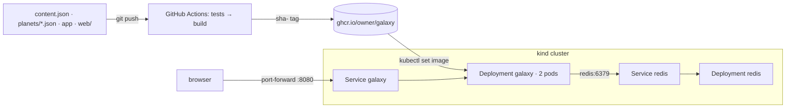

# Portfolio Galaxy

A student portfolio as a 3D galaxy. You start on the **home planet**, the welcome page. Zoom out and every planet in orbit is one of my **projects**. Land on a planet to open its page.

The same app also works for a team. A planet can be a **person**: it gets its own landing page, and each of its **moons** is one of that person's projects.

The whole thing is **one Docker image** plus **Redis** as the supporting service. Redis counts visits.

## What it does

- `/`: the 3D galaxy, with a planet list, search and a tag filter.
- `/welcome`: the home planet. It has the about text, every planet, and a tag filter (`/welcome?tag=docker`).
- `/p/<planet>`: either a project page or a person's landing page.
- `/p/<planet>/<project>`: a moon's project page.
- `/api/galaxy` and `/api/projects?tag=…`: JSON, which the 3D page draws from.
- `/health`: returns `{"status": "ok"}`, used by the readiness probe.
- A visit counter in Redis. If Redis is down, the counts show "—" and every page still works.

## Install first

- Docker Desktop (or Docker Engine with the Compose plugin)
- Python 3.12 and Node 22, to run it without Docker
- `kubectl` and [kind](https://kind.sigs.k8s.io/), for Kubernetes

## Run it locally (no Docker)

```bash
python -m venv .venv && source .venv/bin/activate
pip install -r requirements-dev.txt
pytest -q tests                          # 16 tests
(cd web && npm ci && npm test && npm run build)
REDIS_HOST=localhost python app.py       # http://localhost:8000
```

To work on the 3D page with live reload, run `cd web && npm run dev`. Vite serves the page and forwards everything else to Flask on port 8000.

## Docker

```bash
docker build -t galaxy .
docker run --rm -p 8080:8000 -e ENVIRONMENT=docker galaxy
# http://localhost:8080/health  →  {"status":"ok",...}
```

How the Dockerfile is built:

- **Stage 1** (`node:22.17.0-alpine`) runs the 3D page's tests and builds it.
- **Stage 2** (`python:3.12.11-slim`) installs the requirements before copying the code, so code changes don't reinstall anything.
- It copies in only the built `web/dist`.
- It runs gunicorn as user 10001, not root.

`.dockerignore` keeps `.git`, `.env`, tests, `node_modules` and the Kubernetes files out of the build. Without Redis, the counter shows "—". That's expected.

## Compose

```bash
cp .env.example .env        # optional: change GALAXY_OWNER, GALAXY_COLOR, ENVIRONMENT
docker compose up --build   # http://localhost:8080
```

There are two services:

- `galaxy`: this image.
- `redis`: `redis:7.4.2-alpine`.

The app finds Redis through `REDIS_HOST=redis`, which is the Compose service name. `galaxy` waits for Redis's health check before it starts.

## CI/CD

`.github/workflows/ci.yml` runs on **every push to main and every pull request**:

1. **test**: pytest for the app, Vitest for the 3D page, and hadolint on the Dockerfile.
2. **image**: needs `test` to pass first. It builds the image.
   - On a pull request it only builds, to prove the image builds.
   - On `main` it also logs in to GHCR with the built-in `GITHUB_TOKEN` and pushes `ghcr.io/<owner>/galaxy:sha-<7 chars>`. That same tag is passed in as `APP_VERSION`, so the page and `/health` show which build is running.

The pipeline stops at publishing. It doesn't deploy. After the first push, make the package public: GitHub → your profile → Packages → galaxy → Package settings → Change visibility.

## Kubernetes (kind)

```bash
kind create cluster --name galaxy
# Put the sha- tag from your latest green run into k8s/galaxy.yaml (image: ...), then:
kubectl apply -f k8s/
kubectl get pods -w                         # wait for 2/2 galaxy and 1/1 redis READY
kubectl port-forward svc/galaxy 8080:80     # http://localhost:8080
```

| Object | What it does |
| --- | --- |
| `Deployment galaxy` | Keeps 2 replicas of the image running. It replaces a pod that dies, and rolls out a new tag one pod at a time (`maxSurge 1`, `maxUnavailable 0`). |
| readiness probe | `GET /health` every 5 s. A pod only gets traffic once it answers. |
| `Service galaxy` | One stable name and IP in front of whichever galaxy pods are ready. |
| `Deployment` + `Service redis` | The counter. The galaxy reaches it as `redis:6379`. |
| `env:` | Every setting lives in the Deployment, so changing one is `kubectl apply`, not a rebuild. `POD_NAME` comes from the pod's own name. |

### Operations

```bash
kubectl scale deploy/galaxy --replicas=3              # the footer shows a different pod as you refresh
kubectl delete pod <a-galaxy-pod>                     # the Deployment starts a replacement
kubectl set image deploy/galaxy galaxy=ghcr.io/<owner>/galaxy:sha-<new>
kubectl rollout status deploy/galaxy
kubectl rollout undo deploy/galaxy                    # back to the previous tag
kubectl get pods; kubectl describe pod <pod>; kubectl logs deploy/galaxy
```

## Environment variables

| Variable | Default | What it changes |
| --- | --- | --- |
| `GALAXY_OWNER` | `owner` in content.json | The name on the pages and in the title |
| `GALAXY_TITLE` | "<owner>'s Galaxy" | The galaxy's title |
| `GALAXY_COLOR` | `#f2c56b` | The home planet's color and the page accent |
| `ENVIRONMENT` | `local` | The environment badge on every page and in the 3D view |
| `APP_VERSION` | `dev` | The image tag. CI sets it. |
| `POD_NAME` | the hostname | Which replica answered. Kubernetes fills it in. |
| `REDIS_HOST` / `REDIS_PORT` | `redis` / `6379` | Where the counter lives |
| `CONTENT_DIR` | the repo folder | Where `content.json` and `planets/` are read from |

## Adding a planet

**A project planet:** add an entry to `planets` in `content.json`:

```json
{ "slug": "k8s-lab", "title": "Kubernetes Lab", "summary": "…", "tags": ["kubernetes"],
  "size": "large", "appearance": { "style": "ice", "rings": { "on": true } }, "body": ["…"] }
```

`size` is `small`, `medium` or `large`. `style` is `banded`, `rocky`, `ice`, `lava` or `ocean`.

**A person with moons (team mode):** add `planets/<name>.json` with a `projects` list. Each project becomes a moon. Every teammate edits only their own file, so nobody's commits collide. See `examples/team/` for a full team galaxy, and try it with `CONTENT_DIR=examples/team python app.py`.

Then `git push` → CI publishes a new `sha-` image → `kubectl set image` → the new planet appears.

## Architecture



### Architecture notes

- **One image for the whole galaxy.** Projects are data that gets built into the image. That makes every change a new tagged image, which makes rollouts and rollbacks real and easy to show.
  - *Tradeoff:* editing a project means a rebuild, not a live edit.
- **Redis is optional by design.** The counter is the only thing that needs it. `/health` doesn't check Redis, so a Redis outage never takes the galaxy out of the Service.
  - *Tradeoff:* the counts reset when the Redis pod restarts, because there's no volume. The checklist says that's fine, and it's a good example of containers and state.
- **The 3D page is static.** Node only exists in the build stage, so the shipped image is just Python and the built files.

## A real problem we hit

<!-- Replace this with the problem YOUR team hit and fixed: the checklist grades your own story. -->

When I first ran the app as the non-root user (uid 10001), gunicorn exited at once. `kubectl logs` (and `docker logs` locally) showed `Error: can't chdir to '/…/app'`. The files had been copied somewhere that user couldn't read, so the process couldn't even enter its working directory.

The fix was to keep the app in a directory the user can read (`WORKDIR /app`, with files readable by everyone) and to run the check as uid 10001 before trusting it. The lesson: a non-root container fails on file permissions first, and the logs say exactly where.
