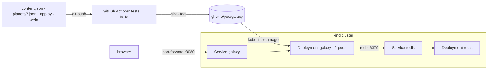

# Portfolio Galaxy

Your portfolio as a 3D galaxy. Visitors land on your **home planet**, which is your welcome page. When they zoom out, every planet in orbit is one of your **projects**. Clicking a planet and landing on it opens that project's page.

The whole galaxy is **one Docker image** (a Flask app plus the 3D page), with **Redis** beside it counting visits. GitHub Actions builds the image and publishes it to GHCR, and you run it on Kubernetes with kind.

This README takes you from nothing to your own galaxy running on Kubernetes, one step at a time. Do the parts in order.

| Part | You finish with | Time |
| --- | --- | --- |
| [1 · Install the tools](#1--install-the-tools) | Git, Python, Node, Docker, kind and kubectl working | 30–60 min, once |
| [2 · Get your own copy](#2--get-your-own-copy) | Your own repo on GitHub, cloned on your computer | 10 min |
| [3 · Run it on your computer](#3--run-it-on-your-computer) | The sample galaxy at `localhost:8080` | 10 min |
| [4 · Make it yours](#4--make-it-yours) | Your name, your welcome text, your projects as planets | 20+ min |
| [5 · Publish it with CI](#5--publish-it-with-ci) | Your image on GHCR, built by GitHub Actions | 15 min |
| [6 · Run it on Kubernetes](#6--run-it-on-kubernetes-kind) | Your galaxy on a kind cluster | 20 min |
| [7 · Add a planet and roll it out](#7--add-a-planet-and-roll-it-out) | A new planet live, a rollback practiced | 15 min |

**How to read the steps:** "Run" means type the command into **Git Bash** (Windows) or **Terminal** (Mac) and press Enter, one block at a time. "Open `file`" means open it in VS Code. Lines starting with `#` are comments; you can paste them, and the shell ignores them.

---

## 1 · Install the tools

Install each one, then run its check command. If the check doesn't print what's shown, fix that tool before going on.

| Tool | Windows | Mac | Check (run) | You should see |
| --- | --- | --- | --- | --- |
| Git + Git Bash | [git-scm.com](https://git-scm.com/download/win), all defaults | `xcode-select --install` | `git --version` | `git version 2.…` |
| VS Code | [code.visualstudio.com](https://code.visualstudio.com) | same | `code --version` | a version number |
| Python 3.12 | [python.org](https://www.python.org/downloads/), tick **Add python.exe to PATH** | `brew install python@3.12` | `python --version` (Mac: `python3 --version`) | `Python 3.12.x` |
| Node 22 LTS | [nodejs.org](https://nodejs.org) | `brew install node@22` | `node --version` | `v22.…` |
| Docker Desktop | [docker.com](https://www.docker.com/products/docker-desktop/), restart after | same | `docker run --rm hello-world` | `Hello from Docker!` |
| kind | `winget install Kubernetes.kind` | `brew install kind` | `kind version` | `kind v0.…` |
| kubectl | `winget install Kubernetes.kubectl` | `brew install kubectl` | `kubectl version --client` | `Client Version: v1.…` |

On Windows, **close and reopen Git Bash** after installing, so it sees the new tools. Docker Desktop must be **running** (whale icon in the taskbar) whenever you use `docker` or `kind`.

> **Windows: `error getting credentials … docker-credential-desktop … not found`** when you build or pull?
> Run `sed -i '/"credsStore"/d' ~/.docker/config.json` and try again. Docker Desktop sometimes adds that line back after an update; run the same command again if it does.

---

## 2 · Get your own copy

You need your own repo, because GitHub Actions publishes the image under **your** GitHub name.

1. On GitHub, open this repo and click **Fork** (top right) → **Create fork**. You now have `github.com/<your-username>/<repo>`.
2. In your fork, click the **Actions** tab → **I understand my workflows, go ahead and enable them**. Forks start with Actions turned off.
3. Clone your fork and open it. Run, with your username and repo name:

```bash
cd ~
git clone https://github.com/<your-username>/<repo>.git portfolio-galaxy
cd portfolio-galaxy
git config user.name "Your Name"
git config user.email "you@example.com"     # the email on your GitHub account
code .
```

From now on, every command runs from inside this folder (`~/portfolio-galaxy`). If you're ever unsure where you are, run `pwd`, then `cd ~/portfolio-galaxy`.

<details>
<summary>Starting from an empty repo instead of a fork</summary>

Create an empty **Public** repo on GitHub with nothing in it (no README or .gitignore), then:

```bash
cd ~
git clone https://github.com/<owner>/<this-repo>.git portfolio-galaxy
cd portfolio-galaxy
git remote set-url origin https://github.com/<your-username>/<your-new-repo>.git
git push -u origin main
```
</details>

---

## 3 · Run it on your computer

### 3a · The quick way: Docker Compose (recommended)

This runs everything (the 3D page, the app and Redis) with one command. Start Docker Desktop first.

```bash
cd ~/portfolio-galaxy
docker compose up --build
```

The first build takes a few minutes while it downloads the base images. It's ready when the log shows `galaxy-1 | … Listening at: http://0.0.0.0:8000`. Then open:

| Address | What you'll see |
| --- | --- |
| `http://localhost:8080` | The 3D galaxy. Click **Zoom out**, click the planet, then **Land on planet** |
| `http://localhost:8080/welcome` | Your landing page (the home planet) |
| `http://localhost:8080/p/sample-project` | The sample planet's page |
| `http://localhost:8080/health` | `{"status":"ok","version":"dev"}` |

To stop it, press **Ctrl+C**, then run `docker compose down`.

### 3b · Without Docker (for quick edits)

First, set up Python once:

```bash
cd ~/portfolio-galaxy
python -m venv .venv
source .venv/Scripts/activate          # Mac: source .venv/bin/activate
pip install -r requirements-dev.txt
pytest -q                              # 16 passed
```

Your prompt now starts with `(.venv)`. In every new terminal you open for this project, run the `source` line again; without it you'll get `pytest: command not found`.

Then run the app in one terminal:

```bash
python app.py                          # http://localhost:8000/welcome
```

And the 3D page in a second terminal:

```bash
cd ~/portfolio-galaxy/web
npm ci                                 # first time only
npm run dev                            # http://localhost:5173
```

The visit counter shows — without Redis. That's expected: the pages still work, only the counter is missing.

---

## 4 · Make it yours

Everything a visitor sees comes from **`content.json`** in the repo folder. You don't need to touch any code.

### 4a · Your home planet (the landing page)

Open `content.json` and change the top part:

```json
{
  "owner": "Your Name",
  "headline": "Welcome to my student portfolio",
  "tagline": "A one-line introduction goes here.",
  "about": "The planet you start on is home. Every planet in orbit is one of my projects.",
  "home": {
    "appearance": { "style": "ocean", "clouds": true, "atmosphere": { "strength": 0.85 }, "spin": "slow" }
  },
  "links": [
    { "label": "GitHub", "url": "https://github.com/your-username" }
  ],
```

| Field | What it changes |
| --- | --- |
| `owner` | Your name in the title ("Your Name's Galaxy") and on the landing page |
| `headline` | The big heading on the welcome screen and landing page |
| `tagline` | The line under it |
| `about` | The paragraph on the landing page |
| `home.appearance.style` | How the home planet looks: `banded`, `rocky`, `ice`, `lava` or `ocean` |
| `links` | Buttons on the landing page. Add as many as you like, each `{ "label": …, "url": … }` |

The home planet's **color** is set by `GALAXY_COLOR` in `compose.yaml` (or `.env`), not in this file. See [Environment variables](#environment-variables).

### 4b · Your projects (the planets)

Lower down, `"planets": [ … ]` is the list of planets. Each `{ … }` block is one project. Replace the sample with your own, and copy the block to add more, with a **comma between blocks**:

```json
  "planets": [
    {
      "slug": "flask-todo-api",
      "title": "Dockerized Flask To-Do API",
      "summary": "A small REST API in a slim, non-root image.",
      "tags": ["flask", "docker"],
      "size": "large",
      "appearance": { "style": "banded", "color": "#d98c5f", "rings": { "on": true, "color": "#d9c9a3", "tilt": 22 } },
      "body": [
        "What the project is and what you built.",
        "What you learned doing it."
      ]
    },
    {
      "slug": "ci-to-ghcr",
      "title": "CI Pipeline to GHCR",
      "summary": "Tests first, then a sha- tagged image.",
      "tags": ["ci"],
      "size": "medium",
      "appearance": { "style": "lava", "color": "#e0452b" }
    }
  ]
}
```

| Field | Required? | What it does |
| --- | --- | --- |
| `slug` | yes | The page address: `/p/<slug>`. Lowercase letters, numbers and hyphens only. No two planets can share one |
| `title` | yes | The planet's name, on its label and its page |
| `summary` | | One line under the title |
| `tags` | | Words for the tag filter (`/welcome?tag=docker`) |
| `size` | | `small`, `medium` or `large`: how big the planet is. Anything else becomes `medium` |
| `appearance.style` | | `banded`, `rocky`, `ice`, `lava` or `ocean` |
| `appearance.color` | | Any hex color, like `"#3a7bd5"` |
| `appearance.rings` | | `{ "on": true, "color": "#…", "tilt": 20 }` for Saturn-style rings |
| `appearance.clouds`, `spin` | | `true` for clouds; `spin` is `"slow"`, `"normal"` or `"fast"` |
| `body` | | The paragraphs on the project's page, as a list of strings |

Planets fill the rings from the inside out: the first 4 go on the inner ring, the next 5 on the second, and so on.

### 4c · Two ways to add planets: one list, or one file each

You don't have to put every planet in `content.json`. Any `.json` file you put in the **`planets/`** folder is also a planet. The app reads both and combines them into one galaxy, so you can use either way or mix them.

| | In `content.json` | As files in `planets/` |
| --- | --- | --- |
| How | Add a `{ … }` block to the `"planets": [ … ]` list | Create `planets/<something>.json` holding one planet block |
| Good for | A solo galaxy, with everything in one place | Teams (each person edits only their own file, so nobody's changes collide), or keeping each project in its own file |
| Order in orbit | The order they're listed in | Set by `"order"`: lower numbers sit closer to the home planet |

The same rules apply both ways: every planet needs a `slug` and a `title`, and no two planets can share a `slug`, across the list and all the files. The tests check this.

**Example: one project in its own file.** Create `planets/flask-todo-api.json`:

```json
{
  "slug": "flask-todo-api",
  "order": 1,
  "title": "Dockerized Flask To-Do API",
  "summary": "A small REST API in a slim, non-root image.",
  "tags": ["flask", "docker"],
  "size": "large",
  "appearance": { "style": "banded", "color": "#d98c5f" },
  "body": ["What you built.", "What you learned."]
}
```

**Example: a person with moons (team galaxy).** Give a planet a `projects` list and it becomes a person: it gets a landing page at `/p/<slug>`, and each project becomes a **moon** with its own page at `/p/<slug>/<project-slug>`. Create `planets/yourname.json`:

```json
{
  "slug": "yourname",
  "order": 1,
  "title": "Your Name",
  "summary": "Your role · what you own",
  "about": "A sentence or two about you.",
  "appearance": { "style": "ocean", "color": "#3a9bd5", "clouds": true },
  "projects": [
    { "slug": "first-project", "title": "First Project", "summary": "One line.", "tags": ["docker"] },
    { "slug": "second-project", "title": "Second Project", "summary": "One line.", "tags": ["python"] }
  ]
}
```

A `projects` list works inside `content.json` too: moons aren't tied to the folder. For a team galaxy, set the team's name in `owner` and `headline` in `content.json`, give each teammate their own file in `planets/` with a different `order`, and keep only shared projects (or none: `"planets": []`) in `content.json`.

**Not using the folder?** You can delete it, but then also delete the line `COPY planets/ planets/` from the `Dockerfile`, or the build fails with `"/planets": not found`.

### 4d · Check your changes and see them

JSON is strict: no comments, no comma after the last item, and every `"` closed. The tests check your file for you:

```bash
source .venv/Scripts/activate          # if (.venv) isn't on your prompt
pytest -q
```

If `test_my_content_json_is_valid` fails, its message says what's wrong (a missing slug, a repeated slug). If every test fails with `JSONDecodeError … line 23`, look near line 23 of `content.json` for a missing or extra comma.

Then rebuild and look:

```bash
docker compose up --build              # Ctrl+C, then docker compose down, when you're done
```

The content is built into the image, so it only changes after `--build`.

### 4e · Save it to GitHub

```bash
git add content.json
git commit -m "My galaxy: home planet and projects"
git push
```


---

## 5 · Publish it with CI

`.github/workflows/ci.yml` runs on **every push to `main` and every pull request**:

1. **`test`**: pytest for the app, Vitest for the 3D page, and hadolint on the Dockerfile.
2. **`image`**: only starts if `test` passed. It builds the image. On a pull request it stops there. On a push to `main` it also logs in to GHCR with GitHub's built-in `GITHUB_TOKEN` (no secret to set up) and pushes `ghcr.io/<your-username>/galaxy:sha-<first 7 characters of the commit>`. The same tag is passed into the image as `APP_VERSION`, so `/health` and every page footer show which build is running.

It stops at publishing; it doesn't deploy. You do that in part 6.

**Your first published image:**

1. You already pushed in 4e. On GitHub, open your repo's **Actions** tab. Click the newest run and wait for both jobs to turn green (3–5 minutes).
2. Click the **image** job → expand **Image name and tag**. You'll see `tag=sha-4f2c1a9` (yours will differ). **Write it down.**
3. Make the image public, so Kubernetes can pull it without a password: your GitHub profile → **Packages** → **galaxy** → **Package settings** → **Change visibility** → **Public**.
4. Check it pulls as a stranger would:

```bash
docker logout ghcr.io
docker pull ghcr.io/<your-username>/galaxy:sha-4f2c1a9
```

`<your-username>` is always **lowercase** in image names, even if your GitHub name has capitals.

If a run goes red, click the red job, then the red step: the error is at the bottom. Fix it, then commit and push again.

---

## 6 · Run it on Kubernetes (kind)

### 6a · Create a cluster

```bash
kind create cluster --name galaxy
kubectl get nodes                      # galaxy-control-plane   Ready
```

### 6b · Point the manifest at your image

Open `k8s/galaxy.yaml` and find this line:

```yaml
          image: ghcr.io/YOUR-GITHUB-USER/galaxy:sha-0000000
```

Change it to your lowercase username and the tag from part 5, for example:

```yaml
          image: ghcr.io/your-username/galaxy:sha-4f2c1a9
```

In the same file, change `GALAXY_OWNER`'s value to your name.

### 6c · Deploy

```bash
kubectl apply -f k8s/
kubectl get pods -w
```

Wait until you see two `galaxy-…` pods and one `redis-…` pod, all `1/1 Running`, then press **Ctrl+C**.

### 6d · Open it

```bash
kubectl port-forward svc/galaxy 8080:80
```

Leave that running and open `http://localhost:8080`. The badge now says `kubernetes`, and the footer of `/welcome` shows which pod answered and your `sha-` tag. Press **Ctrl+C** to stop the port-forward. The cluster keeps running.

### What each part does

| File / object | What it does |
| --- | --- |
| `k8s/galaxy.yaml` → `Deployment galaxy` | Keeps 2 copies (replicas) of your image running, replaces any that die, and updates them one at a time (`maxSurge 1`, `maxUnavailable 0`) |
| readiness probe | Calls `GET /health` every 5 s. A pod gets no traffic until it answers |
| `env:` | Every setting, as plain values. Change one and `kubectl apply` again; no rebuild |
| `POD_NAME` | Filled in by Kubernetes with the pod's own name, shown in the page footer |
| `Service galaxy` | One stable name and port (80) in front of the ready galaxy pods |
| `k8s/redis.yaml` | A Deployment and a Service for Redis. The galaxy finds it as `redis:6379`, by name |

---

## 7 · Add a planet and roll it out

This is the full loop: edit, push, CI builds a new image, Kubernetes swaps it in with no downtime.

1. Add a planet block to `content.json` (part 4b), then run `pytest -q`.
2. Push it:

   ```bash
   git add content.json
   git commit -m "Add a planet"
   git push
   ```

3. Wait for the green run in **Actions**, and copy the new tag from **image → Image name and tag**.
4. Roll it out:

   ```bash
   kubectl set image deploy/galaxy galaxy=ghcr.io/<your-username>/galaxy:sha-<new-tag>
   kubectl rollout status deploy/galaxy       # … successfully rolled out
   ```

5. Run the port-forward again and reload: the new planet is in orbit.
6. Practice undoing it:

   ```bash
   kubectl rollout undo deploy/galaxy         # back to the previous tag; the new planet disappears
   ```

7. Put the tag you want to keep into `k8s/galaxy.yaml` and commit it. Otherwise a later `kubectl apply` puts the old tag back.

**Other things to try:**

```bash
kubectl scale deploy/galaxy --replicas=3       # reload /welcome: the footer's pod name changes
kubectl delete pod <one-galaxy-pod-name>       # the Deployment starts a replacement on its own
kubectl scale deploy/redis --replicas=0        # visit counts show —, the pages still work
kubectl scale deploy/redis --replicas=1
```

When you're finished: `kind delete cluster --name galaxy`.

---

## Environment variables

Set these in `compose.yaml` (or a `.env` file copied from `.env.example`) for Compose, and under `env:` in `k8s/galaxy.yaml` for Kubernetes. None of them needs a rebuild.

| Variable | Default | What it changes |
| --- | --- | --- |
| `GALAXY_OWNER` | `owner` in content.json | The name on the pages and in the title |
| `GALAXY_TITLE` | "<owner>'s Galaxy" | The galaxy's title |
| `GALAXY_COLOR` | `#f2c56b` | The home planet's color and the page accent |
| `ENVIRONMENT` | `local` | The environment badge on every page |
| `APP_VERSION` | `dev` | The image tag; CI sets it |
| `POD_NAME` | the hostname | Which pod answered; Kubernetes sets it |
| `REDIS_HOST` / `REDIS_PORT` | `redis` / `6379` | Where the visit counter lives |
| `CONTENT_DIR` | the repo folder | Where `content.json` and `planets/` are read from |

---

## When something goes wrong

| You see | Why | Fix |
| --- | --- | --- |
| `pytest: command not found` | The virtual environment is off in this terminal | `source .venv/Scripts/activate` (Mac: `.venv/bin/activate`) |
| `error getting credentials … docker-credential-desktop` | A Docker Desktop setting on Windows | `sed -i '/"credsStore"/d' ~/.docker/config.json` |
| `curl: (56) Recv failure` right after `docker run` | The app needs a few seconds to start | Wait 5 seconds, try again |
| `port is already allocated` | Something else is on 8080 or 6379 | `docker ps`, then `docker stop <name>` |
| Your edit doesn't show | The content is inside the image | `docker compose up --build` (Compose), or push and `kubectl set image` (Kubernetes) |
| All tests fail with `JSONDecodeError` | A typo in `content.json` | Check the line number it names for a missing or extra comma |
| Pod stuck `ImagePullBackOff` | Wrong image name, wrong tag, or the package is still private | `kubectl describe pod <pod>`: read Events. Fix the `image:` line or make the package public |
| Pod in `CrashLoopBackOff` | The app crashes on start | `kubectl logs <pod>` shows the Python error |
| CI run is red | A test, the lint or the build failed | Actions → the red job → the red step; the error is at the bottom |

---

## How it fits together



**What's in the repo:**

| Path | What it is |
| --- | --- |
| `content.json`, `planets/` | Your galaxy's content |
| `app.py`, `templates/`, `static/` | The Flask app: `/welcome`, `/p/…` pages, `/api/galaxy`, `/health`, the visit counter |
| `web/` | The 3D galaxy (Three.js), built by the Dockerfile's first stage |
| `Dockerfile`, `.dockerignore` | Stage 1 (Node) builds the 3D page; stage 2 (`python:3.12.11-slim`) installs requirements before copying code, and runs gunicorn as user 10001, not root |
| `compose.yaml` | The galaxy and Redis on one machine |
| `.github/workflows/ci.yml` | Tests, then build; publish to GHCR on `main` |
| `k8s/` | Deployments and Services for the galaxy and Redis |
| `tests/`, `pytest.ini` | 16 tests, including one that checks your `content.json` |

### Architecture notes

- **The whole galaxy is one image.** Projects are built into it, so every change is a new tagged image you can roll out and roll back. *Tradeoff:* fixing a typo means a rebuild, not a live edit.
- **Redis is optional by design.** `/health` doesn't check it, so if Redis goes down the galaxy stays in service and only the counter goes blank. *Tradeoff:* there's no volume, so counts reset when the Redis pod restarts.
- **Node is only in the build stage.** The shipped image is Python plus the built files. *Tradeoff:* the first build is slower, until Docker caches the `npm ci` layer.

## A real problem we hit

<!-- Replace this with the problem YOUR team hit and fixed: the checklist grades your own story. -->

When we first ran the image, `curl localhost:8080/health` right after `docker run` failed with `Recv failure: Connection was aborted`, and it looked like the container was broken. `docker ps` showed it `Up` with `health: starting`, and a few seconds later `/health` answered normally. Gunicorn takes a moment to start, and we had sent the request before it was listening. The fix was to wait for the health check (`docker ps` shows `(healthy)`) before testing. It's also why the Kubernetes readiness probe matters: Kubernetes waits for exactly that before sending a pod any traffic.
